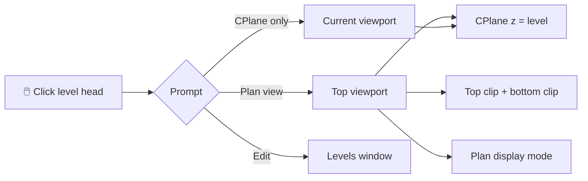
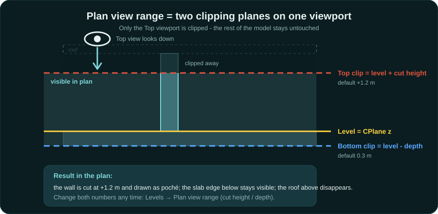
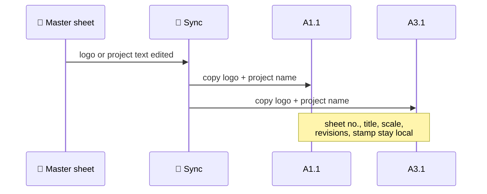
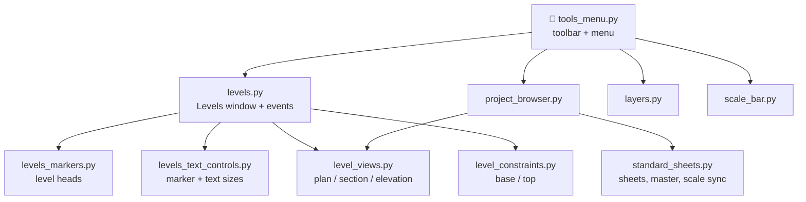

<div align="center">



<br/>


**Turn Rhino into a Revit-style workflow — levels that drive views, base/top constraints, sheets and a master title block. One toolbar. One installer.**

[**⬇ Download CAPYBARA_Setup.exe**](https://github.com/Escanor-sinofpride/CAPYBARA/raw/main/CAPYBARA_Setup.exe) &nbsp;·&nbsp; [Install](#-install) &nbsp;·&nbsp; [Levels](#-levels--click-a-level-land-on-its-plan) &nbsp;·&nbsp; [Constraints](#-base--top-constraints) &nbsp;·&nbsp; [Sheets](#-sheets--master-sheet) &nbsp;·&nbsp; [How it works](#-how-it-works)

</div>

---

## ✨ What you get

| | |
|---|---|
| 🏢 **Levels that drive views** | Click a level head and land on that level's plan: Top view, CPlane at the level, and a proper view range. |
| 📐 **Base / Top constraints** | Same logic as Revit walls: Base Constraint + Offset, Top Constraint + Offset, or Unconnected. Move a level and objects re-fit. |
| 🗂️ **Project Browser** | Level plans, sections, elevations, model views and sheets in one list. Add levels and sheets from it. |
| 📄 **Sheets + Master sheet** | Standard sheet set, scale that follows the view, and one master page that controls the logo and project name everywhere. |
| 📏 **Scale bar** | Architectural scale overlay for model and layout views. |
| 🎨 **Drafting standard** | Layers, line weights, annotation styles, blocks and display modes set up in one command. |

> [!NOTE]
> CAPYBARA gives Rhino a Revit-like **workflow**. It is not a BIM database: objects are still Rhino geometry that carry level constraints as user text.

---

## 📦 Install



1. **Download** [`CAPYBARA_Setup.exe`](https://github.com/Escanor-sinofpride/CAPYBARA/raw/main/CAPYBARA_Setup.exe) and run it. No administrator rights are needed.
2. Keep **“Open Rhino 8 and finish installing CAPYBARA now”** ticked on the last page.
3. In Rhino, press **Yes** in the confirmation window. The toolbar and commands are added and any previous version is backed up.

> [!TIP]
> Windows may show *“unknown publisher”* because the installer is not code-signed. Choose **More info → Run anyway**.

<details>
<summary><b>Manual install (without the .exe)</b></summary>

1. Open Rhino 8 and run `ScriptEditor`.
2. Open the plugin installer `.py` and press **Run** (or use the command line):
   ```
   _-ScriptEditor _Run "C:\path\to\CAPYBARA_installer.py"
   ```
3. Press **Yes** in the confirmation window.

Everything installs per user in `%APPDATA%\CustomArchitectureTools\8`.
</details>

---

## 🏢 Levels — click a level, land on its plan



Click a **level head** (triangle in elevations, quarter-filled circle in 3D) and CAPYBARA asks what you want:

| Choice | What happens |
|---|---|
| **Switch to this level's plan view** | The Top viewport opens, its **CPlane moves to the level**, the view range is applied and the viewport comes to the front — also when your viewports are maximized. |
| **Only set my view's CPlane** | You stay where you are (Perspective, Front…) and your CPlane sits at the level elevation. |
| **Edit this level** | The Levels window comes forward with that level selected: rename, set elevation, add constraints. |

Prefer no pop-up? **Levels → Level-head click action…** can be set to *Ask me every time*, *Always switch to the plan view* or *Do nothing*.



### Plan view range



A plan is not a flat copy of the model — it is the Top viewport with **two clipping planes** that belong only to that viewport. Cut height (default **1.2 m**) and view depth (default **0.3 m**) are editable from **Levels → Plan view range**.

<details>
<summary><b>The idea in code</b> (simplified from <code>level_views.py</code>)</summary>

```python
# CPlane at the level elevation
vp.SetConstructionPlane(Plane(Point3d(0, 0, z), Vector3d.XAxis, Vector3d.YAxis))

# Replace this viewport's previous clips, then add the view range
clear_clips(doc, vp.Id)
add_clip(doc, vp.Id, Point3d(cx, cy, z + cut_m * m),   Vector3d.ZAxis,      size, "plan-top")
add_clip(doc, vp.Id, Point3d(cx, cy, z - depth_m * m), Vector3d(0, 0, -1),  size, "plan-bottom")
```
Clip planes are tagged with the viewport id, so switching level only touches that viewport.
</details>

---

## 📐 Base / Top constraints



Select objects → **Levels → Set constraints (base / top + offsets)…**

| Property | Meaning |
|---|---|
| **Base Constraint** + **Base Offset** | The level the object sits on, plus an offset in metres. |
| **Top Constraint** + **Top Offset** | The level it reaches, or **Unconnected** to keep its own height. |

Change a level's elevation, or drag its marker, and every constrained object is re-fitted: stretched when it has a top constraint, moved when it is unconnected. Deleting a level asks first and releases the constraints without moving geometry.

<details>
<summary><b>The idea in code</b> (simplified from <code>level_constraints.py</code>)</summary>

```python
def fit_transform(lo, hi, tlo, thi):
    """Map the object's z-range [lo, hi] onto the constrained range [tlo, thi]."""
    k = (thi - tlo) / (hi - lo)
    scale = Transform.Scale(Plane(Point3d(0, 0, lo), Vector3d.ZAxis), 1, 1, k)
    return Transform.Translation(0, 0, tlo - lo) * scale
```
Constraints are stored as object user text: `LEVEL`, `BASE_OFFSET`, `TOP`, `TOP_OFFSET`.
</details>

---

## 🗂️ Project Browser

Run **`CATProjectBrowser`** — one list for everything you navigate:

| Entry | Does |
|---|---|
| `PLAN :: Level 01` | Opens that level's plan (CPlane + view range). |
| `SECTION :: …` / `ELEVATION :: …` | Opens a saved section or elevation view. |
| `+ NEW LEVEL(S)` | Adds one or several levels (count, floor-to-floor height, name prefix). |
| `+ NEW SECTION VIEW` · `+ NEW 4 ELEVATION VIEWS` | Creates views from a line or from the model extents. |
| `+ NEW SHEET(S)` | Adds as many sheets as you like: number, name, scale, paper size. |
| `+ CHANGE SHEET SCALE` | Sets the scale of one or all sheets and updates the title blocks. |
| `+ MASTER SHEET …` | Opens, edits or applies the master sheet. |
| `MODEL ::` / `SHEET ::` | Jumps to any model view or sheet. |

---

## 📄 Sheets + Master sheet



- **Shared from the master:** logo and project name / address.
- **Local to each sheet:** sheet number, title, scale, revisions, stamp.
- Put your logo (picture, curves or blocks) **inside the LOGO cell** of the master page and edit the project text there — every formatted sheet follows when you finish the command.
- **Scale follows the view:** change the scale of a sheet's main view and the `1:100` text in the title block updates by itself.



---

## 🧰 Commands

| Command | Opens |
|---|---|
| `DBENASUBIM` / `CATools` | Main menu of all tools |
| `CATLevels` | Levels window, markers and constraints |
| `CATProjectBrowser` | Project Browser |
| `CATScale` | Scale bar overlay and scale controls |
| `CATLayers` | Drafting standard: layers, styles, blocks, display modes |
| `CATUninstall` | Removes toolbar, commands and unchanged files |

---

## 🔧 How it works



| Module | Role |
|---|---|
| `levels.py` | Levels window, events, level elevations, click-a-head behaviour. |
| `level_views.py` | Activates plan / section / elevation: viewport, CPlane, clipping planes. |
| `level_constraints.py` | Base / top constraints and re-fitting when levels move. |
| `levels_markers.py` | Draws level heads and lines. |
| `levels_text_controls.py` | Drawing scale, marker sizes and text sizes. |
| `project_browser.py` | The browser list and its actions. |
| `standard_sheets.py` | Sheet creation, master sheet, scale sync. |
| `scale_bar.py` | On-screen scale bar. |
| `layers.py` | Drafting standard. |

Levels live in the `.3dm` itself (document strings), so they travel with your file.

---

## ✅ Requirements

- Windows 10 / 11
- **Rhino 8** (Python 3 Script Editor)

## 🩹 Troubleshooting

<details>
<summary><b>The view stays in Perspective after choosing the plan view</b></summary>

With a maximized viewport CAPYBARA restores it and maximizes the Top viewport. If it still does not switch, copy the last lines of the command history — it prints `View: PLAN - …` on success or a line starting with `Levels:` on error.
</details>

<details>
<summary><b>“Unexpected UTF-8 BOM” when installing</b></summary>

Update to the latest installer — it reads the install manifest with or without a BOM. If it still appears, delete `%APPDATA%\CustomArchitectureTools\8\install_manifest.json` and run the installer again.
</details>

<details>
<summary><b>“hatch pattern not found” / “Solid hatch pattern is unavailable”</b></summary>

Blank templates may not contain Rhino's built-in hatch patterns. The latest version adds the missing ones automatically; run `CATLayers` once more.
</details>

<details>
<summary><b>Clipping removes the wrong side</b></summary>

Set `CLIP_SIGN = -1.0` at the top of `level_views.py`.
</details>

## 🗑️ Uninstall

Run **`CATUninstall`** in Rhino, or use *Apps & features → CAPYBARA*. The Windows uninstaller offers to open Rhino to remove the toolbar and commands first.

## 🛣️ Roadmap

- [x] Levels with plan, section and elevation views
- [x] Base / top constraints with offsets
- [x] New levels and sheets from the Project Browser
- [x] Master sheet and scale sync
- [ ] Auto-assign new objects to the nearest level
- [ ] View templates (per-view visibility, scale, display)
- [ ] Door / room / area schedules
- [ ] Docked, tree-style Project Browser
- [ ] Place a chosen view on a sheet

> [!WARNING]
> CAPYBARA is under active development. Try it on a **copy** of your model first.

<div align="center">

<sub>Built for architects who think in levels. 🦫</sub>

</div>
